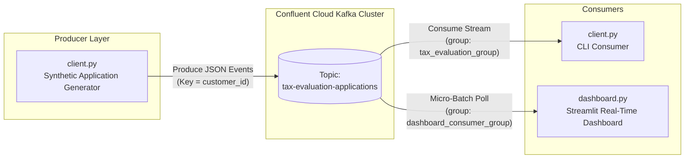
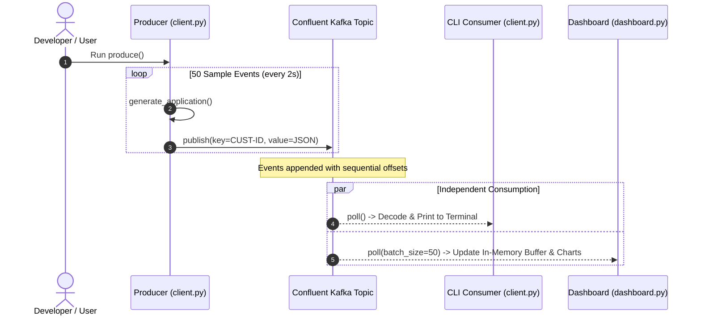
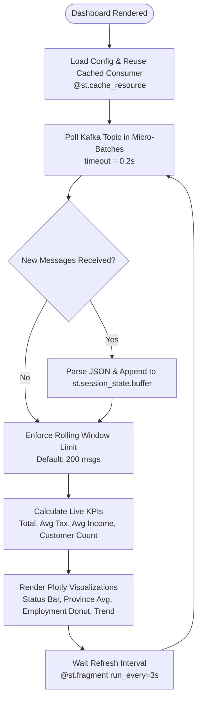

# 📊 Real-Time Event Streaming: Tax Evaluation Prototype

A beginner-friendly, end-to-end prototype demonstrating **Event-Driven Architecture (EDA)** with **Apache Kafka** (via **Confluent Cloud**), **Python**, and a live **Streamlit** dashboard.

---

## Table of Contents

- [Project Overview](#project-overview)
- [The Problem We Are Solving](#the-problem-we-are-solving)
- [Core Concepts for Beginners](#core-concepts-for-beginners)
- [System Architecture & Visual Diagrams](#system-architecture--visual-diagrams)
  - [1. End-to-End System Flow](#1-end-to-end-system-flow)
  - [2. Kafka Producer-Consumer Mechanics](#2-kafka-producer-consumer-mechanics)
  - [3. Dashboard Real-Time Polling Loop](#3-dashboard-real-time-polling-loop)
- [Event Data Schema](#event-data-schema)
- [Project Structure](#project-structure)
- [Prerequisites & Environment Setup](#prerequisites--environment-setup)
- [Configuration (`client.properties` / `.env`)](#configuration-clientproperties--env)
- [Step-by-Step Quickstart](#step-by-step-quickstart)
- [Dashboard Features & Analytics](#dashboard-features--analytics)
- [Troubleshooting & Common Pitfalls](#troubleshooting--common-pitfalls)
- [Next Steps & Enhancements](#next-steps--enhancements)

---

## Project Overview

This prototype demonstrates how modern enterprise applications ingest, stream, process, and visualize transactional records in **real time** instead of relying on legacy, slow batch files.

Using a **Tax Evaluation Application** scenario, the project simulates taxpayer submissions across provinces in South Africa, transmits them as discrete events over a Confluent Cloud Kafka cluster, and visualizes live financial and compliance metrics (tax due, status distribution, employment mix, regional analytics) on an interactive dashboard.

---

## The Problem We Are Solving

Traditional financial and public sector tax systems often process submissions in **overnight batch jobs** or write directly to a single central database:

| Traditional Batch / Monolithic Approach | Modern Event-Driven Approach (This Project) |
| :--- | :--- |
| **Delayed Visibility:** Stakeholders must wait hours or days for reports. | **Instant Visibility:** Applications appear on dashboards within milliseconds of submission. |
| **Tight Coupling:** Producers and consumers share database locks and schemas. | **Loose Coupling:** Producers publish events without knowing who consumes them. |
| **Fragile Scalability:** High tax season spikes can overwhelm backend databases. | **High Scalability:** Kafka safely buffers millions of incoming events per second. |
| **Single Purpose Data:** Difficult to plug in new auditing or fraud microservices. | **Multi-Consumer Reusability:** Multiple independent systems can read the same stream. |

### Prototype Goal

To build a functional **proof-of-concept (POC)** showing:

1. How to generate and stream realistic domain events into an Apache Kafka topic.
2. How to consume and deserialize Kafka event streams reliably in Python.
3. How to build an interactive, non-blocking real-time analytical dashboard using Streamlit and Plotly.

---

## Core Concepts for Beginners

If you are new to Apache Kafka and Event Streaming, here are the key building blocks:

- **Event:** A small packet of data representing something that happened (e.g., *"Application APP-10001 submitted by John"*).
- **Producer:** An application that creates events and sends them into Kafka ([`client.py`](client.py:179)).
- **Topic:** A named category/folder in Kafka where events are stored (e.g., `tax-evaluation-applications`).
- **Broker (Cluster):** The distributed server(s) running Kafka that receive, store, and serve events.
- **Consumer:** An application that reads and processes events from a Kafka topic ([`client.py`](client.py:215), [`dashboard.py`](dashboard.py:108)).
- **Consumer Group:** A label shared by a set of consumers so Kafka tracks which messages have been read (offsets) for that specific group.
- **Offset:** A sequential ID number given to each message within a topic partition so consumers know where they left off.

---

## System Architecture & Visual Diagrams

### 1. End-to-End System Flow

This diagram illustrates how data flows from simulation to transmission, consumption, and visualization.



---

### 2. Kafka Producer-Consumer Mechanics

This diagram highlights how messages are serialized, routed into Kafka, and read independently by distinct consumer groups.



---

### 3. Dashboard Real-Time Polling Loop

This diagram shows how [`dashboard.py`](dashboard.py) handles state management, non-blocking polling, and visual chart rendering without re-triggering consumer rebalances.



---

## Event Data Schema

Each message sent by the producer represents a tax filing event serialized as JSON:

```json
{
  "application_id": "APP-10001",
  "customer_id": "CUST-1001",
  "customer_name": "John Nkosi",
  "email": "john.cust-1001@example.com",
  "country": "South Africa",
  "province": "Gauteng",
  "tax_year": 2023,
  "income": 75000,
  "tax_due": 18250.50,
  "currency": "ZAR",
  "employment_type": "Full-Time",
  "status": "Submitted",
  "submitted_date": "2023-08-14"
}
```

- **Message Key:** `customer_id` (Ensures events for the same customer land in deterministic partitions if multi-partitioned).
- **Message Value:** Serialized JSON payload containing demographic, financial, and status details.

---

## Project Structure

```text
Confluent-RT-Event-Streaming/
├── client.py                 # Kafka Producer & CLI Consumer scripts
├── dashboard.py              # Real-time Streamlit & Plotly analytics dashboard
├── client.properties         # Confluent Cloud connection credentials (local / git-ignored)
├── client.properties.example # Sample properties file for local Kafka client configuration
├── .env.example              # Sample environment variable template
├── requirements.txt          # Python package dependencies
└── README.md                 # Project documentation and learning guide
```

| File | Description |
| :--- | :--- |
| [`client.py`](client.py:1) | Generates synthetic tax applications, produces 50 events at 2-second intervals, and includes a standalone CLI consumer. |
| [`dashboard.py`](dashboard.py:1) | Streamlit web application that polls Kafka continuously, computes live metrics, and renders dark-themed Plotly charts. |
| [`client.properties.example`](client.properties.example:1) | Template for configuring Confluent Cloud credentials and bootstrap servers. |
| [`.env.example`](.env.example:1) | Reference template for environment variables. |
| [`requirements.txt`](requirements.txt:1) | Specifies required versions for `confluent-kafka`, `streamlit`, `pandas`, and `plotly`. |
| [`README.md`](README.md:1) | Comprehensive, beginner-friendly learning guide with system architecture diagrams. |

---

## Prerequisites & Environment Setup

### 1. Prerequisites

- **Python 3.10, 3.11, or 3.12** installed on your system.
- An active **Confluent Cloud** account (or a local Apache Kafka broker).

### 2. Create and Activate a Virtual Environment

**On Windows (PowerShell):**

```powershell
# Create virtual environment
python -m venv venv

# Set execution policy (if script execution is restricted)
Set-ExecutionPolicy -Scope Process -ExecutionPolicy Bypass

# Activate environment
.\venv\Scripts\Activate.ps1
```

**On macOS / Linux:**

```bash
# Create virtual environment
python3 -m venv venv

# Activate environment
source venv/bin/activate
```

### 3. Install Dependencies

```bash
pip install -r requirements.txt
```

---

## Configuration (`client.properties` / `.env`)

You can create `client.properties` by copying the provided [`client.properties.example`](client.properties.example:1) or referencing [`.env.example`](.env.example:1):

**Windows (PowerShell):**

```powershell
Copy-Item client.properties.example client.properties
```

**macOS / Linux:**

```bash
cp client.properties.example client.properties
```

Populate `client.properties` with your Confluent Cloud cluster settings:

```properties
# Confluent Cloud Kafka Cluster Configuration
bootstrap.servers=<YOUR_CONFLUENT_BOOTSTRAP_SERVER>
security.protocol=SASL_SSL
sasl.mechanisms=PLAIN
sasl.username=<YOUR_API_KEY>
sasl.password=<YOUR_API_SECRET>

# Optional Client Config
session.timeout.ms=45000
```

> ⚠️ **Security Note:** Never commit `client.properties` or API secrets to version control. Add `client.properties` to your `.gitignore`.

*(For Streamlit Community Cloud deployments, [`dashboard.py`](dashboard.py:48) also supports native `st.secrets["kafka"]` integration).*

---

## Step-by-Step Quickstart

Follow these steps to run the complete event streaming pipeline:

### Step 1: Create the Kafka Topic

In your Confluent Cloud Console, create a topic named:

- **Topic Name:** `tax-evaluation-applications`
- **Partitions:** 1 (or more)
- **Retention:** Default (7 days)

---

### Step 2: Launch the Streamlit Dashboard

Open a terminal and start the real-time dashboard:

```bash
streamlit run dashboard.py
```

Your browser will open automatically at `http://localhost:8501`. Initially, the dashboard will display:
> *"No data yet — waiting for messages on the topic."*

---

### Step 3: Produce Sample Events

Open a **second terminal**, activate your virtual environment, and run:

```bash
python client.py
```

You will see live output in your terminal:

```text
Produced -> Application=APP-10001 Customer=CUST-1001 Status=Submitted
Produced -> Application=APP-10002 Customer=CUST-1005 Status=Under Audit
...
```

Watch your Streamlit dashboard update live every 3 seconds as messages are published!

---

### Step 4: Run the CLI Consumer (Optional)

If you wish to view events in the terminal via a command-line consumer, [`client.py`](client.py:278) automatically starts the consumer loop after producing completes, or you can call `consume(topic, config)` directly.

---

## Dashboard Features & Analytics

The real-time dashboard ([`dashboard.py`](dashboard.py)) includes:

1. **Top-Level KPI Metrics:**
   - **Total Events:** Number of applications ingested in the active window.
   - **Avg Tax Due (ZAR):** Real-time calculated mean tax liability.
   - **Avg Income (ZAR):** Mean declared income across submissions.
   - **Distinct Customers:** Unique customer count.

2. **Interactive Visualizations:**
   - **Applications by Status (Bar Chart):** Real-time distribution across statuses (*Submitted*, *Pending Review*, *Under Audit*, *Approved*, *Rejected*, *Refund Issued*, etc.).
   - **Employment Type Mix (Donut Chart):** Breakdown of *Full-Time*, *Part-Time*, *Contractor*, *Self-Employed*, and *Retired*.
   - **Avg Tax Due by Province (Horizontal Bar Chart):** Regional tax contribution across South African provinces.
   - **Income Distribution (Histogram):** Distribution curve of reported earnings.
   - **Tax Due Trend (Time Series):** Tax amounts plotted across application submission dates.

3. **Live Event Stream Table:**
   - Displays the most recent 50 raw records with sorting and column inspection.

4. **Sidebar Controls:**
   - Configurable auto-refresh interval (default: 3s).
   - Batch drain size per refresh cycle.
   - Rolling buffer retention limit (default: 200 items).
   - Clear buffer button.

---

## Troubleshooting & Common Pitfalls

### 1. `FileNotFoundError: [Errno 2] No such file or directory: 'client.properties'`

- **Cause:** The configuration file is missing from the working directory.
- **Fix:** Create `client.properties` in the root folder with your Confluent Cloud connection details.

### 2. `librdkafka` build errors during `pip install`

- **Cause:** Unsupported Python version or missing pre-built wheels.
- **Fix:** Ensure you are using Python 3.10–3.12 on 64-bit OS. Upgrade pip first:

  ```bash
  python -m pip install --upgrade pip
  pip install -r requirements.txt
  ```

### 3. Dashboard not showing messages

- **Cause:** The consumer group has already committed offsets past existing messages, or the producer hasn't run yet.
- **Fix:** In the Streamlit sidebar, change the **Consumer group id** (e.g., to `dashboard_group_v2`) to start consuming from the earliest offset, or run `python client.py` to stream fresh events.

---

## Next Steps & Enhancements

To expand this prototype into a production-grade system, consider:

- [ ] **Schema Registry:** Enforce data contracts using Apache Avro or Protobuf.
- [ ] **Stream Processing with Apache Flink / ksqlDB:** Detect anomalous tax submissions and fraud in real time.
- [ ] **Database Sink Connector:** Stream finalized applications automatically to PostgreSQL, MongoDB, or Snowflake via Kafka Connect.
- [ ] **Dead Letter Queue (DLQ):** Route invalid JSON payloads to an error topic for remediation.

---

Made with ❤️ as a beginner-friendly Event Streaming prototype.
